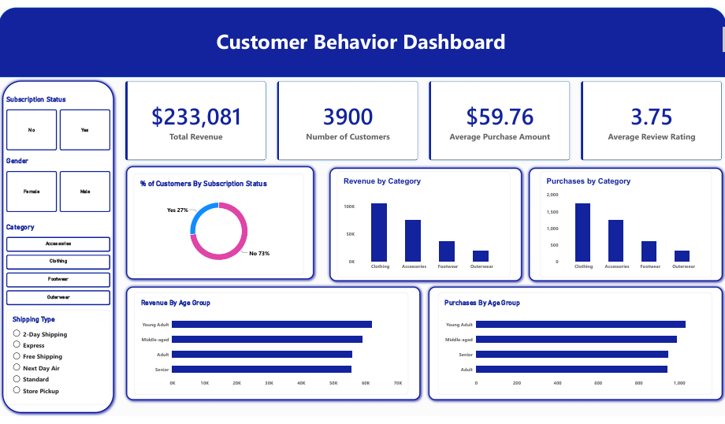

# Customer Behavior Analysis (Python, SQL, Power BI)

An end-to-end data analytics project on customer shopping data. I cleaned the data in Python, answered 10 business questions with SQL, and built an interactive Power BI dashboard.

Author: Abdessamad Jamed

I followed Amlan Mohanty's tutorial for the workflow, the business questions and the dataset. I wrote the code and the conclusions myself and added my own checks (duplicates, unique IDs, per-gender and overall-rate comparisons).



## Business problem

A retail company wants to understand how its customers shop, so it can improve sales and keep customers longer. The questions are about who buys, what they buy, and whether discounts and subscriptions make a difference.

## Dataset

- Customer Shopping Behavior dataset, taken from the GitHub repository of the tutorial I followed (Amlan Mohanty, "Complete Data Analytics Portfolio Project in 6 Easy Steps"): [tutorial repository](https://github.com/amlanmohanty1/customer-trends-data-analysis-SQL-Python-PowerBI)
- 3,900 customers, 18 columns (age, gender, category, purchase amount, review rating, subscription status, discount, previous purchases, and more)
- Each row is one customer and their latest purchase
- This is a practice dataset, so the results are for learning and not for real business decisions

## Tools

- Python (pandas) for cleaning and new columns
- PostgreSQL for SQL analysis
- Power BI for the dashboard
- Git and GitHub

## What I did

**1. Data cleaning (Python)**
- Filled 37 missing review ratings with the median rating of each category
- Renamed columns to snake_case
- Created `age_group` (4 equal-sized groups) and `purchase_frequency_days` (text frequency turned into days)
- Dropped `promo_code_used` because it was identical to `discount_applied`
- Checked for duplicates: none, and 3,900 unique customer IDs

**2. SQL analysis (PostgreSQL)**
10 business questions answered with GROUP BY, subqueries, CASE, CTEs and a window function. All queries and my short conclusions are in `queries.sql`.

**3. Dashboard (Power BI)**
KPI cards (total revenue, customers, average purchase, average rating), charts by category and age group, and slicers for subscription, gender, category and shipping type.

## Main findings

- Total revenue is 233,081 and the average purchase is 59.76
- Men bring about twice the revenue of women (157,890 vs 75,191), but only because there are more men (2,652 vs 1,248). Average spend is almost the same (59.54 vs 60.25)
- 27% of customers are subscribed. Subscribers and non-subscribers spend the same on average (59.49 vs 59.87)
- Repeat buyers subscribe a bit more than the others (27.56% vs 22.41%), but most of them are still not subscribed
- The overall discount rate is 43%. Hat has the highest at 50%
- About 80% of customers are loyal (more than 10 previous purchases)
- Revenue is spread almost evenly across age groups (23.9% to 26.7%)
- Clothing is the top category in both revenue and number of purchases

## Limitations

- One row per customer with only the latest purchase, so there are no dates and no trends over time
- Practice dataset, not real company data

## Files

```
data/                                  raw and cleaned CSV files
images/dashboard.png                   dashboard screenshot
01_cleaning.ipynb                      data cleaning and loading into PostgreSQL
queries.sql                            10 SQL queries with conclusions
customer_behavior_dashboard.pbix       Power BI file
dashboard.pdf                          dashboard as PDF
```

## How to run

1. Install Python and PostgreSQL
2. Install the libraries: `pip install pandas sqlalchemy psycopg2-binary jupyter`
3. Create a database called `customer_behavior`
4. Run `01_cleaning.ipynb` and enter your PostgreSQL password when asked
5. Run the queries in `queries.sql`
6. Open the `.pbix` file in Power BI Desktop and connect it to your database
